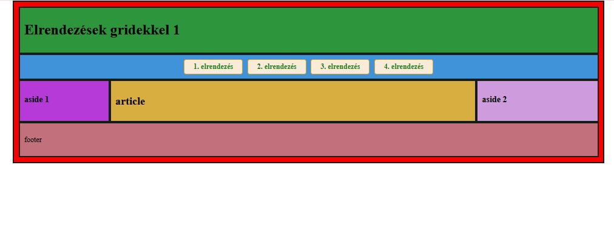
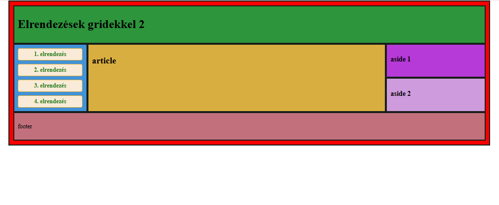
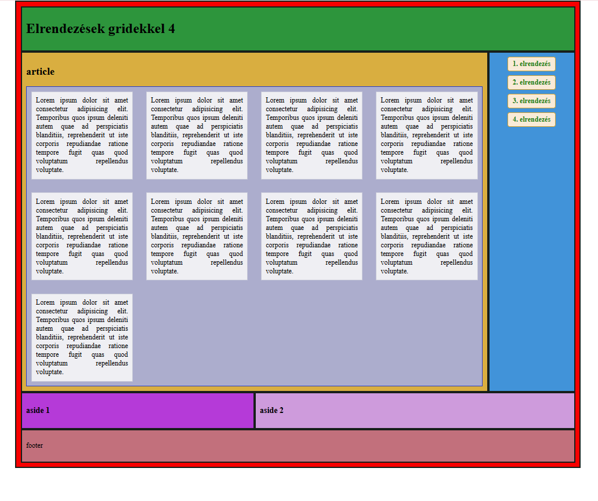

# Oldalelrendezés gridekkel

## index.html

Az index.html oldalhoz csatolj egy index.css stílusfájlt, és abban alakítsd ki a mintán látható elrendezést. 
Készíts legalább 1 töréspontot is. Mobil nézetben a menüpontok egymás alatt legyenek, a header alatt legyen a nav, az alatt az article, az alatt az egyik, majd a másik aside elem, legalul a footer. 

## grid2.html

Az grid2.html oldalhoz csatolj egy grid2.css stílusfájlt, és abban alakítsd ki a mintán látható elrendezést. 
Készíts legalább 1 töréspontot is. Mobil nézetben a menüpontok egymás alatt legyenek, a header alatt legyen a nav, az alatt az article, az alatt az egyik, majd a másik aside elem, legalul a footer. 

## grid3.html

Az grid3.html oldalhoz csatolj egy grid3.css stílusfájlt, és abban alakítsd ki a mintán látható elrendezést. 
Készíts legalább 1 töréspontot is. Mobil nézetben a menüpontok egymás alatt legyenek, a header alatt legyen a nav, az alatt az article, az alatt az egyik, majd a másik aside elem, legalul a footer. 

## grid4.html

Az grid4.html oldalhoz csatolj egy grid4.css stílusfájlt, és abban alakítsd ki a mintán látható elrendezést. 
Készíts legalább 1 töréspontot is. Mobil nézetben a menüpontok egymás alatt legyenek, a header alatt legyen a nav, az alatt az article, az alatt az egyik, majd a másik aside elem, legalul a footer. 

